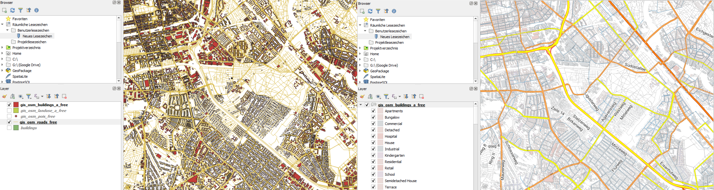
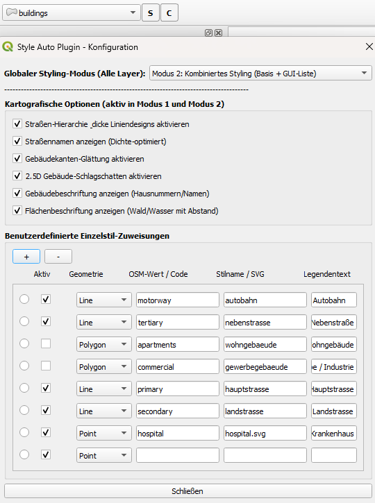
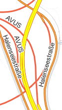
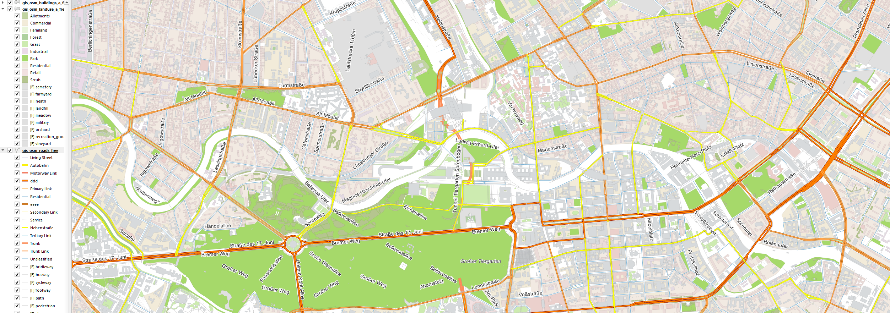
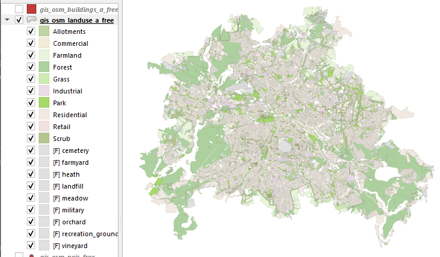

# Style Auto Plugin

[](https://github.com/HeinzDanner/style_auto_plugin/actions/workflows/tests.yml)

*A QGIS Python plugin that automatically applies categorized styling for roads, buildings, land use, and POIs to the active vector layer, driven by a JSON rule configuration and a PyQt settings dialog.*

Style Auto Plugin is a QGIS Python plugin that applies categorized styling to the
selected layer, or adjusts its existing style without loading a base style.

Styling rules are loaded efficiently from the configuration. Rulesets are selected by layer name, geometry type, field name, and priority. For values that are not explicitly configured, an optional fallback style can be applied.



## Project Context

This was my first Python project and my first hands-on work with a GIS API (QGIS/PyQt). My background is Java/JVM, so the goal here was to get comfortable with a new language and ecosystem while still applying the engineering habits I use professionally: writing tests against real objects instead of trusting manual clicking, tracking down root causes instead of patching symptoms, and keeping a clean, reviewable commit history.

Several rounds of real-world testing surfaced concrete bugs (checkboxes silently not wired to the logic they were supposed to control, wrong QGIS API method names, config values read in one place but never in another). Each one was fixed with a regression test added alongside it — the `tests/` suite grew out of that process rather than being planned upfront.

## How It Works

The plugin is essentially a small rule engine, not a fixed set of hardcoded styles:

```text
Active layer
   │
   ▼
score_match()          -> scores every configured layer/profile ruleset against the
                           layer's geometry type, name, and field names/values
   │
   ▼
find_layer_ruleset() /
find_style_profile()  -> picks the highest-priority ruleset whose match score clears
                           its configured minimum threshold
   │
   ▼
get_matching_field_ruleset() -> within that ruleset, picks the best-matching field
                                 (by name hints, priority, and detected values)
   │
   ▼
apply_categorized_renderer_with_fallback()
   │                   -> builds a QGIS categorized renderer: one QGIS symbol per
   │                      configured value, with an optional fallback style for any
   │                      value that has no explicit rule
   ▼
Styled layer + (Mode 1/2) optional road/building/land-use/label refinements
```

Mode 3 bypasses this base-styling pipeline and applies the configured options
and GUI mappings directly to the existing renderer.

Everything above the QGIS-symbol level is driven entirely by `style_rules.json` /
`style_config.json` — adding a new layer type or value mapping is a config change,
not a code change. The interesting/non-trivial part is the scoring and priority
logic in `score_match()`, `find_layer_ruleset()`, and `find_style_profile()`
(`style_engine.py`), which lets the plugin guess the right ruleset for a layer
even when layer and field names don't match exactly.

## Features

- Automatic selection of the most suitable layer ruleset.
- Priority-based selection of the appropriate field ruleset.
- Four global styling modes (Mode 0, 1, 2, and 3).
- Landuse polygons keep their JSON base colors in modes 0, 1 and 2. Modes 1 and 2
  additionally apply matching polygon symbols from the GUI list and optional labels.
  Mode 0 does not apply building effects to landuse polygons.
  In mode 1 the landuse legend lists GUI matches individually and summarizes
  the remaining entries as **Andere Werte**, without changing their map symbols.
  Modes 0 and 2 show the full landuse legend again.
- Several optional cartographic settings exposed through the GUI.
- Field-based categorized symbology.
- Duplicate-safe automatic symbol import for testing.
- Fast in-memory caching to avoid repeated disk scans.
- Optional fallback styling for unconfigured values.
- A robust, quiet core without excessive log output.

### Styling modes

| Mode | Behavior |
|---|---|
| 0: Base styling | Applies the configured JSON/QML base style without GUI symbol replacements. |
| 1: Custom single styling | Builds custom road/building/point styling with a fallback; landuse keeps its base colors and applies matching GUI symbols, with a compact legend. |
| 2: Combined styling | Applies the base style first, then GUI symbol replacements and cartographic options. |
| 3: Options only | Keeps the existing style and applies options and matching GUI replacements, without loading a base style. |

### Applying options without base styling

Use **C** to select **Mode 3: Options Only (Keep Existing Style)** and save the
cartographic options and GUI mappings. Then use **S** to apply them to the selected
layer's existing style. Mode 3 never loads JSON rules or QML base styles.
Modes 0, 1 and 2 retain their normal styling behavior.

Single-symbol and categorized renderers are supported. Matching GUI entries
replace only the corresponding symbols and legend texts; unmatched symbols keep
their existing appearance. A single-symbol renderer is converted to categories
only when a GUI entry matches an attribute value, with its original symbol kept
for all other values. A matching classification field (`fclass`, `highway`,
`landuse`, `building`, `type`, `amenity`, or `code`, depending on geometry) is
required for these replacements. Rule-based and graduated renderers are left
unchanged with a warning. Missing or incompatible mapped symbols also produce a
warning instead of silently substituting a default symbol.

In mode 3 the layer-tree legend shows only GUI matches for values present in the
layer, plus one **Andere Werte** entry for the remaining visible categories.
The latter is a representative legend entry: the underlying categories and
their distinct symbols remain intact. Its checkbox switches all summarized
categories on or off together; GUI matches remain independently switchable.
The compact legend and category visibility are saved with the project. Modes 0
and 2 restore the full legend; landuse in mode 1 also uses a compact legend.

### Saving and loading configurations

The configuration dialog (**C**) provides **Speichern ... / Save configuration...**
and **Laden ... / Load configuration...** buttons for JSON files. Export includes
the full configuration: base rules/profiles, global mode, checkbox settings and
all GUI mapping rows with their active flags, geometry, attribute value, symbol
name and legend text. Import replaces the current configuration and mapping
list, including an explicitly empty list. The open dialog updates immediately:
mode, checkboxes and mapping rows reflect the loaded file without reopening it.
Invalid imports leave the current settings unchanged. Close the dialog to persist the
imported settings in the plugin; apply them with **S**.

Configurations reference symbols, SVGs and QML files by name/path; those resources
are not embedded in the JSON export and must be available on the target computer.
Missing symbols are indicated by a row tooltip, without changing the saved active
flag or preventing the user from correcting the name.

## Requirements

- QGIS 3.28 or newer
- A valid configuration file in the plugin directory

The current regression suite has been run on QGIS **3.44.9 (Qt5)** and
**4.2.2 (Qt6)**. QGIS 3.28 has not been separately verified by these runs.

## Plugin Structure

The plugin follows the standard QGIS Python plugin layout, including the extended `styles` resource directory.

```text
style_auto_plugin/
├── __init__.py
├── LICENSE
├── README.md
├── metadata.txt
├── style_auto_plugin.py
├── style_auto_plugin_dialog.py
├── style_config.py
├── style_config.json
├── style_engine.py
├── style_rules.json
└── styles/
    ├── style_symbols.xml
    ├── roads_fclass.qml
    └── hospital.svg
```

## Installation

### Local Installation

1. Copy the `style_auto_plugin` folder into your local QGIS plugin directory.
2. Restart QGIS.
3. Enable the plugin in the Plugin Manager.

Typical plugin directory on Windows:

```text
C:\Users\<Username>\AppData\Roaming\QGIS\QGIS3\profiles\default\python\plugins
```

### Installation from ZIP

1. Package the complete `style_auto_plugin` folder as a ZIP archive.
2. In QGIS, open `Plugins` -> `Manage and Install Plugins...`.
3. Choose `Install from ZIP`.
4. Select the ZIP file and install it.

## Configuration

Rules are loaded from `style_config.json`. Changes in the settings window update
the dialog's configuration immediately and are written to the plugin's local
JSON file when the dialog is accepted with **Close**. Use **S** to apply them.

## Tests

The `tests/` directory contains a pytest suite:

The complete suite currently contains **128 passing tests** on both tested QGIS
versions. GitHub Actions runs only the pure-Python configuration tests; the badge
does not represent the QGIS-dependent tests.

- `test_style_config.py` validates only the parsing and coercion logic in `style_config.py` and can run with any regular Python interpreter, as long as `pytest` is installed. These tests also run in GitHub Actions CI (see the badge above).
- `test_style_engine.py` and `test_style_auto_plugin.py` verify the actual styling logic functionally using real in-memory QGIS layers and therefore require the QGIS Python interpreter (`qgis.core`). They are intended for local execution, not CI, because no QGIS runtime image is available there.
- `test_style_options.py` covers mode 3, preservation of existing symbols,
  compact legends, grouped checkbox toggles and project save/reload.
- `test_config_transfer.py` covers JSON import/export, invalid files, empty
  mapping lists and immediate updates of the open configuration dialog.
  Both also require the QGIS Python interpreter.

Run on Windows, for example, with:

```text
"C:\Program Files\QGIS 3.44.9\bin\python-qgis-ltr.bat" -m pip install pytest
"C:\Program Files\QGIS 3.44.9\bin\python-qgis-ltr.bat" -m pytest tests -v
"C:\Program Files\QGIS 4.2.2\bin\python-qgis.bat" -m pytest tests -v
```

## Usage

1. Load a suitable vector layer in QGIS.
2. Select the desired layer in the legend.
3. Two toolbar buttons are added to QGIS: **S** (Style) and **C** (Configure).
4. Click **C** to open the settings dialog: choose the global styling mode, enable any cartographic options you want (shadow, smoothing, and so on), and optionally add custom single-value style mappings (see table below). Closing this dialog only saves your settings — it does **not** style the layer.
5. Click **S** on the selected layer to actually apply the styling using the current configuration.



### Custom Single-Value Style Mappings

The table at the bottom of the settings dialog (used in modes 1, 2 and 3) lets you map one specific attribute value to one specific style, independent of the JSON ruleset. Example: a line feature with the OSM value `motorway` should be rendered as a highway, using the internal style `autobahn` and the human-readable legend text "Autobahn".

| Column | Meaning | Example |
|---|---|---|
| Active | Whether this row's rule is used at all | enabled |
| Geometry | Expected geometry type of the feature | `Line` |
| OSM Value / Code | The raw technical value found in the data | `motorway` |
| Style Name / SVG | Internal style name, or an SVG file for point symbols | `autobahn` |
| Legend Text | Human-readable label shown in the QGIS legend | `Autobahn` |

## Screenshots







## Behavior for Missing Values

If the layer contains values for which no explicit rule exists, two cases are possible:

- If a fallback style is defined, that style is used.
- If no fallback style is defined, Mode 1 catches those values with a universal fallback entry.

## Current Status

This plugin is currently a working MVP focused on automated, configurable, and user-driven symbology.

## Known Limitations

- Symbol construction is tailored to the current implementation.

## Planned Expansion

- Additional predefined example configurations.

## Lessons Learned / What I'd Do Differently

Coming from Java, a few things stand out in hindsight that I would design differently on a from-scratch rewrite:

- **State duplication:** boolean settings (e.g. "enable building labels") ended up tracked in three places at once — a class attribute on `StyleEngine`, an instance attribute, and a key in the JSON config dict — synced by ad-hoc helper methods. This caused several of the bugs found during testing (a checkbox reacting to the wrong setting, a toggle only working while the settings dialog was open). In Java I would have modeled this as a single immutable config object passed explicitly through the call chain from the start; here it was retrofitted after the fact via a shared `_get_attr()` accessor instead of eliminating the duplication outright.
- **Module size:** `style_engine.py` grew to roughly 2,400 lines covering roads, buildings, land use, and points in one file/class. A cleaner design would split this into one strategy per geometry/feature type (roads, buildings, land use, points), similar to a Strategy or Visitor pattern in Java, instead of one large method with mode/geometry branching.
- **Defensive "kill switch" guards:** several features had multiple redundant early-return guards added independently over time (sometimes three separate places blocking the same code path for the same condition). Consolidating a boolean's effect into exactly one place would have prevented the "toggle off breaks something else entirely" class of bugs I ran into.
- **Testing came later than it should have:** the pytest suite (54 tests, using real in-memory QGIS layers) was added after the initial feature set existed, once bugs from manual testing started piling up. Writing tests alongside the first working version — even a handful — would have caught the API-name bug (`setJoinStyle`/`setCapStyle` don't exist on `QgsSimpleLineSymbolLayer`; the real methods are `setPenJoinStyle`/`setPenCapStyle`) immediately instead of after real-world use.

A special thank you to my Coach **Dominic** and the [Java Development with AI Bootcamp](https://www.neuefische.de/en/bootcamp/java-development) for the guidance and support in structured software development.

## License

This plugin is licensed under the GNU General Public License v2.0 or later (GPL-2.0-or-later). The full license text is available in the `LICENSE` file.

A special thank you to the team and coaches from the [GIS und Web Developer](https://gis-trainer.com) program for their excellent support.